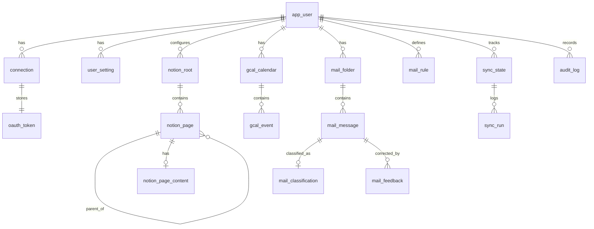

# 데이터베이스 설계 초안 (PostgreSQL)

- 작성일: 20261016
- 원칙: 외부 서비스 데이터는 **캐시**로 저장한다. 원본은 각 서비스에 있다. 토큰은 암호화해 저장한다. 날짜 키는 `CHAR(8)` `YYYYMMDD`(Asia/Seoul 기준)로 둔다. 시각은 `timestamptz`로 둔다.

## 1. 확정된 사항
- 단일 사용자지만 `user_id`를 두어 확장과 테스트 데이터 분리를 쉽게 한다.
- Notion은 데이터베이스가 아니라 페이지 트리로 저장한다(`notion_page`, 부모 관계 포함).

## 2. ERD

## 3. 주요 테이블

### app_user
| 컬럼 | 타입 | 설명 |
|---|---|---|
| id | uuid PK | |
| github_user_id | bigint unique | 로그인 허용 GitHub 숫자 ID(D-06) |
| github_login | text | 표시용(`insunglee-web`). 바뀔 수 있으므로 인증 판단에 쓰지 않는다. |
| display_name | text | |
| timezone | text | 기본 `Asia/Seoul` |
| created_at | timestamptz | |

### connection (외부 서비스 연결)
| 컬럼 | 타입 | 설명 |
|---|---|---|
| id | uuid PK | |
| user_id | uuid FK | |
| provider | text | `google` / `notion` / `naverworks` |
| external_account | text | 외부 계정 식별자(이메일 또는 user id). 표시용 |
| scopes | text[] | 실제 부여받은 scope |
| status | text | `active` / `reauth_required` / `revoked` / `error` |
| last_error | text | 민감정보 제거 후 저장 |
| connected_at, updated_at | timestamptz | |
- unique(user_id, provider)

### oauth_token
| 컬럼 | 타입 | 설명 |
|---|---|---|
| connection_id | uuid PK/FK | |
| access_token_enc | bytea | AES-256-GCM 암호문 |
| refresh_token_enc | bytea null | |
| enc_key_version | int | 키 교체 대비 |
| access_expires_at | timestamptz | |
| refresh_expires_at | timestamptz null | NAVER WORKS 90일 등 |
| version | int | 낙관적 잠금 / 갱신 경쟁 방지 |
| updated_at | timestamptz | |

### user_setting
| 컬럼 | 타입 | 설명 |
|---|---|---|
| user_id | uuid FK | |
| key | text | 예: `mail.vip_senders`, `mail.thresholds`, `notion.max_depth` |
| value | jsonb | |
- PK(user_id, key)

### notion_root
| 컬럼 | 타입 | 설명 |
|---|---|---|
| id | uuid PK | |
| user_id | uuid FK | |
| notion_page_id | text | 회의록 상위 페이지 ID |
| title | text | |
| max_depth | int | 기본 2 |
| title_date_patterns | text[] | 날짜 추출 정규식 우선순위 |

### notion_page
| 컬럼 | 타입 | 설명 |
|---|---|---|
| id | uuid PK | |
| root_id | uuid FK | |
| notion_page_id | text unique | |
| parent_notion_page_id | text | 계층 표현 |
| title | text | |
| meeting_date | char(8) null | 추출한 `YYYYMMDD` (unique 아님. 같은 날 여러 페이지 가능) |
| title_suffix | text null | 날짜 뒤 문자열(예: `사업계획`). 요일 한 글자면 null |
| weekday_mismatch | boolean | 제목의 요일과 실제 요일이 다르면 true |
| date_source | text | `title` / `created_time` / `manual` / `unparsed` |
| url | text | Notion에서 열기 |
| created_time, last_edited_time | timestamptz | Notion 원본 값 |
| content_synced_edited_time | timestamptz | 본문을 수집했을 때의 last_edited_time |
| archived | boolean | 휴지통/삭제 감지 |
| synced_at | timestamptz | |
- index(meeting_date)

### notion_page_content
| 컬럼 | 타입 | 설명 |
|---|---|---|
| page_id | uuid PK/FK | |
| blocks | jsonb | 렌더링용 정규화 블록 트리 |
| plain_text | text | 검색용 |
| block_count | int | |
| truncated | boolean | 상한 초과 여부 |

### gcal_calendar
| 컬럼 | 타입 | 설명 |
|---|---|---|
| id | uuid PK | |
| user_id | uuid FK | |
| google_calendar_id | text | Apps Script `getId()` 값 |
| summary | text | |
| is_writable | boolean | Apps Script `WRITE_CALENDAR_IDS`에 포함 여부(쓰기 버튼 표시 판단). 실제 권한 판단은 스크립트가 한다. |
| color | text | |
| is_visible | boolean | 대시보드 표시 여부 |
| last_window_synced_at | timestamptz null | 마지막 기간 창 동기화 시각(syncToken 대신, D-11) |

### gcal_event
| 컬럼 | 타입 | 설명 |
|---|---|---|
| id | uuid PK | |
| calendar_id | uuid FK | |
| ical_uid | text | Apps Script `getId()`(iCalUID). 반복 일정은 여러 회차가 같은 값을 공유한다. |
| instance_start | timestamptz | 반복 회차 구분용 원래 시작 시각 |
| last_updated_remote | timestamptz | `getLastUpdated()`. 수정할 때 충돌 감지에 쓴다(etag 대신). |
| summary, location, description | text | description은 표시용 길이 제한 |
| start_at, end_at | timestamptz null | 시간 지정 일정 |
| start_date, end_date | char(8) null | 종일 일정 |
| is_all_day | boolean | |
| is_recurring | boolean | true면 읽기 전용(F3-2) |
| missing_since | timestamptz null | 기간 창 조회에서 사라진 시각(삭제 판정) |
- unique(calendar_id, ical_uid, instance_start), index(start_at), index(start_date)

### mail_folder
| 컬럼 | 타입 | 설명 |
|---|---|---|
| id | uuid PK | |
| user_id | uuid FK | |
| folder_id | text | NAVER WORKS 메일함 ID |
| name | text | |
| is_synced | boolean | 수집 대상 여부(기본: 받은메일함) |
| last_seen_mail_id | bigint null | 증분 수집 기준 |
| last_received_time | timestamptz null | |
| unread_count | int | |

### mail_message (메타데이터만, D-03)
| 컬럼 | 타입 | 설명 |
|---|---|---|
| id | uuid PK | |
| folder_id | uuid FK | |
| mail_id | bigint | NAVER WORKS mailId |
| from_name, from_email | text | |
| to_emails | text[] | |
| subject | text | |
| received_at, sent_at | timestamptz | |
| status | text | Read/Unread (수집 시점 기준) |
| is_important_flag | boolean | 발신자가 표시한 중요 |
| security_level | text | General/Restricted/Confidential/Non-business |
| attach_count | int | |
| size_bytes | bigint | |
| first_seen_at | timestamptz | |
- unique(folder_id, mail_id), index(received_at desc)

### mail_classification
| 컬럼 | 타입 | 설명 |
|---|---|---|
| message_id | uuid PK/FK | |
| level | text | `urgent` / `important` / `normal` / `low` |
| score | int | |
| reasons | jsonb | 예: `[{"rule":"vip","weight":40}]` |
| rule_version | int | 규칙 변경 추적 |
| overridden_level | text null | 사용자가 보정한 등급(최종 표시값 우선) |
| classified_at | timestamptz | |

### mail_rule
| 컬럼 | 타입 | 설명 |
|---|---|---|
| id | uuid PK | |
| user_id | uuid FK | |
| type | text | `sender` / `domain` / `subject_keyword` / `security_level` / `flag` |
| pattern | text | |
| weight | int | 음수 가능 |
| enabled | boolean | |

### mail_feedback
| 컬럼 | 타입 | 설명 |
|---|---|---|
| id | uuid PK | |
| message_id | uuid FK | |
| from_level, to_level | text | |
| created_at | timestamptz | |

### sync_state / sync_run
| sync_state 컬럼 | 설명 |
|---|---|
| user_id, source (PK) | `mail` / `calendar` / `notion` |
| lease_until | 실행 잠금 만료 |
| next_run_at | 다음 실행 예정 시각(5분 tick이 이 값을 보고 실행 여부를 판단) |
| last_tick_at | 마지막 tick 수신 시각(heartbeat 점검용) |
| consecutive_failures | 경고 기준 |
| last_success_at | |

| sync_run 컬럼 | 설명 |
|---|---|
| id, source, started_at, finished_at | |
| status | `success` / `partial` / `failed` / `skipped` |
| items_fetched, items_changed, api_calls | 비용·호출량 관찰 |
| error_code, error_message | 민감정보 제거 |

### audit_log
| 컬럼 | 설명 |
|---|---|
| id, user_id, at | |
| action | 예: `calendar.event.create`, `connection.revoke`, `login` |
| target | 외부 ID |
| result | success/failure |
| detail | jsonb (토큰, 본문 제외) |

## 4. 검증이 필요한 사항
- NAVER WORKS `mailId`가 메일함 이동 후에도 같은 값인지(목록 문서에는 "메일 공유 ID"로 표기되어 있음)
- 메일 목록 `status`는 문자열(Read/Unread)이고, 상세 조회 `status`는 비트마스크로 문서에 적혀 있다. 타입 차이를 실제 응답으로 확인해야 한다.
- Apps Script 종일 일정의 종료일이 다음 날(배타적)로 오는지 테스트로 확인한다. 표시할 때 변환이 필요할 수 있다.
- 반복 일정 회차를 `ical_uid + instance_start`로 구분할 수 있는지 PoC에서 확인한다.

## 5. 의사결정 사항
- 확정(20261016): D-03 메일 본문 저장 안 함, D-08 보존 기간(메일 메타데이터 90일, sync_run 30일, audit_log 1년)
- 확정(20261016): D-09 **Supabase Free(서울 `ap-northeast-2`)**. 용량 500MB 안에서 운영한다.
- 남은 결정: 없음.

## 6. Supabase 운영 메모
- 스키마: 앱 테이블은 `app` 스키마에 둔다. Data API에 노출하지 않고 모든 테이블에 RLS를 켠다(security.md 3장).
- 접속: Vercel 함수 → Supabase 연결 풀러(SSL). 마이그레이션은 로컬 PC에서 직접 연결 주소로 실행한다.
- 용량 추정: 메일 메타데이터는 1건당 1KB 미만으로 보고, 하루 200건 × 90일이면 약 18MB다. Notion 본문 JSON과 일정을 합쳐도 500MB에 크게 못 미칠 것으로 본다(관찰 필요).
- 일시정지 방지: Supabase Cron tick이 5분마다 `sync_state`를 갱신한다. 그래도 일시정지 경고 메일이 오면 대시보드 접속 빈도를 확인하고 필요하면 Pro 전환을 검토한다.
- `sync_state.next_run_at`: tick 방식(architecture.md 7장)의 핵심 컬럼이다.
